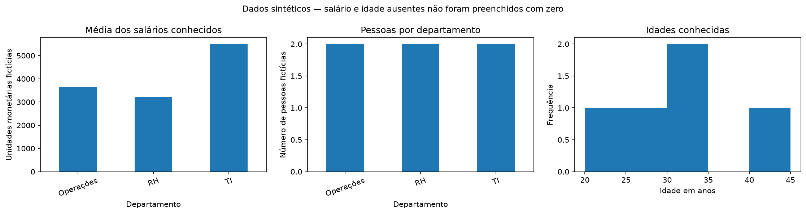

# Minicurso de Python e pandas

Material revisado do minicurso organizado e ministrado por **Gabriel Bitencourt de Souza** na Semana Acadêmica de Engenharia de Produção da UFV. Gabriel liderou o planejamento e a elaboração do material com a equipe e realizou a apresentação principal. Na atividade, as 20 vagas foram preenchidas e a avaliação informada pelos participantes foi de 4,7/5.

Esta edição para estudo e portfólio preserva os temas do notebook apresentado diretamente no Google Colab, corrige pontos técnicos e acrescenta um gabarito comentado. **Todas as bases públicas são sintéticas.** Atletas, clubes, pessoas, salários e vendas são fictícios; as bases originais do Drive não foram republicadas.

## Começar

- [Abrir o minicurso no Google Colab](https://colab.research.google.com/github/GabrielBSouza15/python-pandas-workshop/blob/main/WorkshopPandas.ipynb)
- [Ler o notebook no GitHub](WorkshopPandas.ipynb)
- [Abrir o gabarito no Google Colab](https://colab.research.google.com/github/GabrielBSouza15/python-pandas-workshop/blob/main/WorkshopPandas_gabarito.ipynb)
- [Consultar as correções](CORRECOES.md) e o [dicionário das bases](DADOS.md)

No Colab, conecte-se ao ambiente Python e execute as células em ordem. O notebook prepara seus próprios dados sintéticos: **não é necessário montar o Drive, fornecer credenciais ou enviar arquivos pessoais**. As pastas `minicurso_pandas_dados/` e `minicurso_pandas_saidas/` são usadas e recriadas para os exemplos; não coloque arquivos pessoais nelas.

Pré-requisitos: variáveis, listas, dicionários e comparações básicas em Python.

## Conteúdo

1. Series, DataFrames, rótulos e posições.
2. Leitura e exportação de CSV e Excel.
3. Seleção, filtros booleanos, ordenação e índices.
4. Ausências, repetições e conversão de datas.
5. `groupby`, agregação, `count` versus `size` e tabelas dinâmicas.
6. Gráficos com pandas e Matplotlib.
7. Três exercícios integradores com soluções e verificações de resultados.

O minicurso é introdutório. A revisão destaca decisões de análise: zero não equivale a dado ausente, preencher salário com zero pode distorcer resultados, e eliminar todas as linhas incompletas pode introduzir viés.



## Executar localmente

Com Python 3.10 ou superior, preferencialmente em ambiente virtual:

```bash
python -m pip install -r requirements.txt
python -m jupyterlab
```

Abra um dos notebooks e execute desde a primeira célula. Os CSVs da raiz permitem examinar os exemplos sem executar código; os notebooks geram cópias equivalentes nas pastas de demonstração. O XLSX de treino é criado durante a preparação usando somente o CSV sintético.

## Revisão e validação

Edição revisada em 26/10/2026. A data da revisão não representa a data de realização do evento. O notebook histórico e as bases recebidas foram preservados separadamente. Consulte [VALIDACAO.md](VALIDACAO.md) para o ambiente e os testes executados.

As correções foram verificadas com a documentação oficial do pandas. A organização desta edição, a revisão técnica e o gabarito contaram com apoio do OpenAI Codex. A apresentação e a experiência docente são de Gabriel, com participação da equipe na preparação original; esta publicação não atribui autoria exclusiva de todo o material histórico.

[Gabriel Bitencourt de Souza no LinkedIn](https://www.linkedin.com/in/gabrielbitencourtdesouza/)
